<p align="center">
  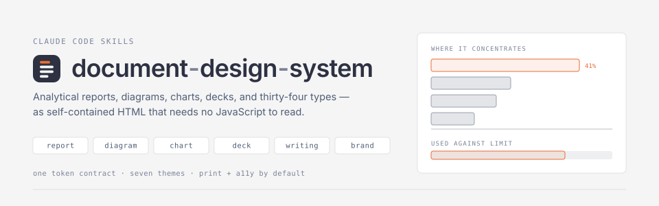
</p>

<p align="center">
  <a href="LICENSE"></a>
  
  
  
  
  
  
  <a href="https://github.com/Avinava/document-design-system/actions/workflows/validate.yml"></a>
</p>

# Documents that get a reader to a decision

## What this is

A plugin for [Claude Code](https://claude.com/claude-code) that makes Claude write
structured, well-designed documents, diagrams, charts and slide decks. You say who will
read the document and what they need to decide or do. Claude picks the document's shape,
writes it from facts that can be checked, and, if you ask for a designed page, gives it a
look that suits the audience.

Most documents fail by being complete, accurate and unreadable: the reader cannot find the
decision, cannot tell what is settled from what is proposed, and has to rebuild the
author's thinking to act. This plugin writes the document around its reader instead.

You do not need to know what a "skill" is. A skill is a set of instructions Claude loads
when a request matches it; this plugin ships six, and you reach them by asking.

**Site:** [avinava.github.io/document-design-system](https://avinava.github.io/document-design-system/) ·
**New here:** [How it works](https://avinava.github.io/document-design-system/how-it-works.html) ·
**Install:** [below](#install)

---

## What you type

Plain words, or a command. Nothing else is needed: no template to fill in.

```text
write the cutover plan for RFC 014
make a primer for engineers joining from batch
turn this inventory export into a report for the platform review
/document-design-system:runbook the lag alert
/document-design-system:postmortem the 30 July ingestion halt
```

Writing lands as Markdown in your repository. A designed page is opt-in: ask for "HTML",
"a PDF" or "a designed page", and say "full width" if you want maps and tables to use the
whole screen (`--width full`). The HTML needs no JavaScript to read, and it prints.

## How it works

1. **You ask.** Name a document, a reader or a question.
2. **A type fits, or the document is composed.** Familiar names such as HLD, PRD or
   RAID route to the matching preset; when none fits, Claude builds one from a pattern.
3. **The pattern sets the reading order and the opening.** A runbook opens on a
   precondition checklist; a postmortem opens on a severity band with the impact numbers.
4. **Modules supply the parts.** An ask band, a timeline, a checkpoint.
5. **For designed output, a theme sets the voice**: type, colour and density.
6. **Every claim carries an evidence state**, and a missing fact stays open.
7. **Checks fail the build** when something is wrong (see [CONTRIBUTING.md](CONTRIBUTING.md)).

The full walk-through, with the pictures, is on the
[How it works page](https://avinava.github.io/document-design-system/how-it-works.html).

## Different documents look different

Each of these is a real example from one fictional engagement. The shape, the first
screen and the voice change with the reader; the facts do not.

| | | |
|---|---|---|
| [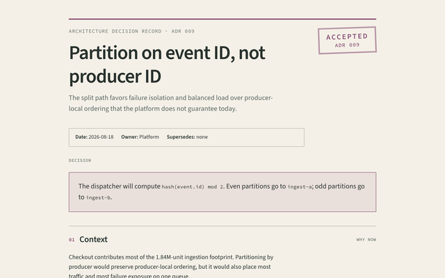](examples/adr.html) | [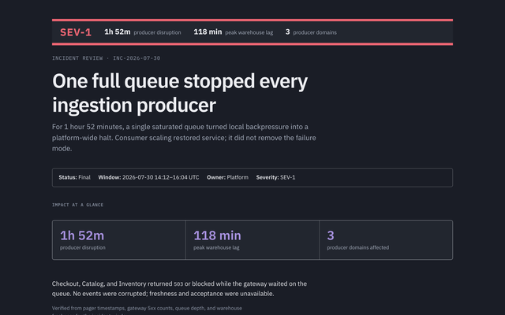](examples/postmortem.html) | [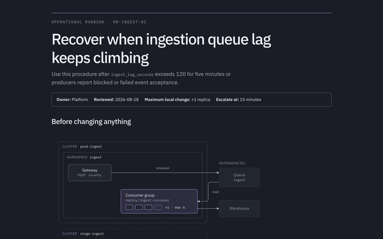](examples/runbook.html) |
| Decision record: status stamp, `serif-editorial` | Postmortem: severity band, `console-violet` | Runbook: precondition checklist, `console-violet` |
| [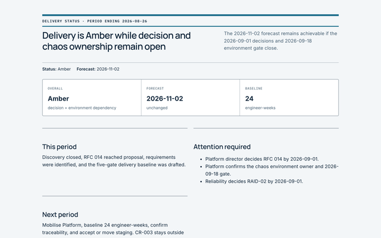](examples/status-report.html) | [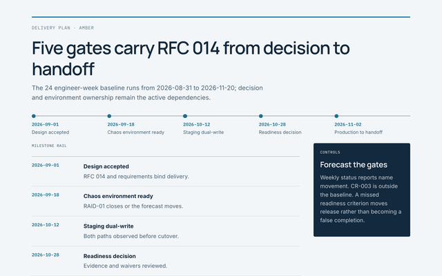](examples/delivery-plan.html) | [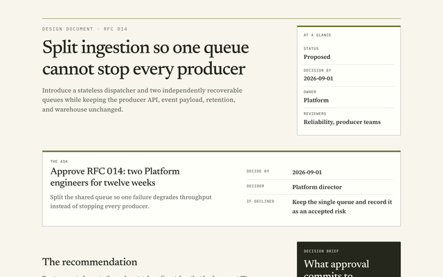](examples/design-doc.html) |
| Status report: dated masthead, `condensed-report` | Delivery plan: milestone rail, `condensed-report` | Design doc: the ask beside the title, `serif-editorial` |
| [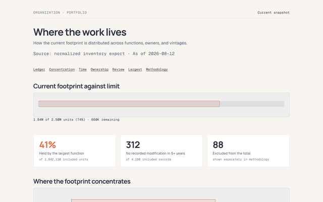](examples/inventory-report.html) | [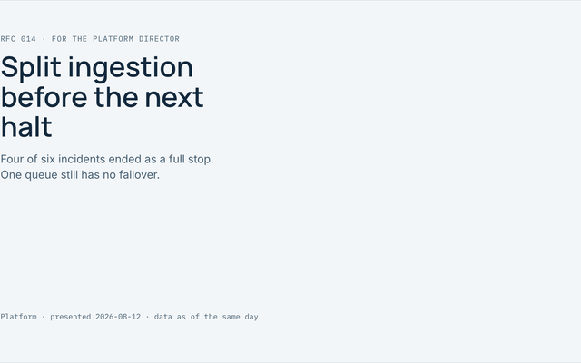](examples/capacity-deck.html) | [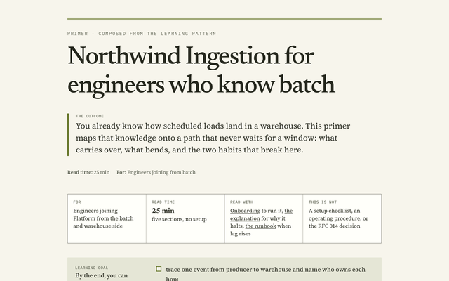](examples/platform-primer.html) |
| Analytical report: the denominator named | Deck: the title names the argument | Platform primer: composed, no preset fits |

Every one of the 34 presets has an example, and the
[Patterns page](https://avinava.github.io/document-design-system/types.html) starts from
the reader's question. The whole set follows one engagement, told in four acts on the
[site](https://avinava.github.io/document-design-system/); its facts are in
[`examples/WORLD.md`](examples/WORLD.md).

[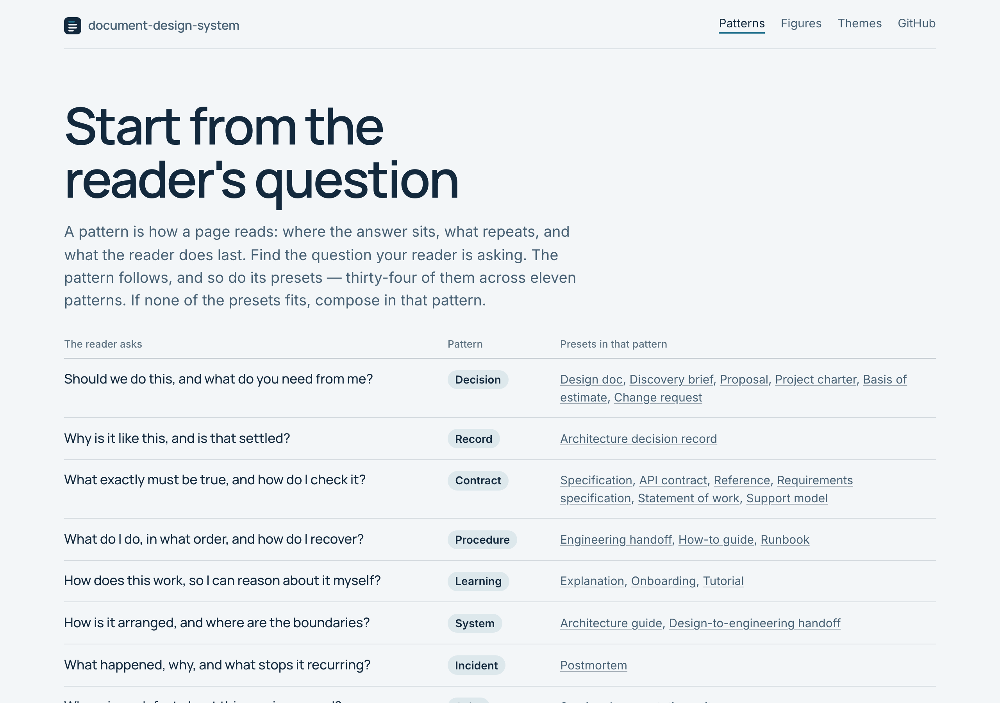](examples/index.html)

---

## Words used here

| Term | Meaning |
|---|---|
| **Pattern** | The reading order of a document: where the answer sits, what repeats, what the reader does last. There are eleven, set with `data-pattern`. Each owns its opening. |
| **Preset** (also **type**) | A ready-made kind of document inside a pattern, such as a runbook or a design doc, with its own command and section order. There are 34. |
| **Module** | One reusable part of a page with one reading job, such as an ask band or a timeline. There are 78; a pattern may use only the modules it allows. |
| **Theme** | A document's voice: type scale, colour, density and ornament, set through tokens and chosen by audience. There are eight (seven finished, plus a template for your own), set with `data-theme`. It never moves a section. |
| **Evidence state** | A label on a claim saying how sure it is: Verified, Provided, Inferred, Unresolved or Recommended. |
| **Compose** | Building a document directly from a pattern's modules when no preset fits. A shape composed three times becomes a preset; that is the only way the catalog grows. |
| **Width** | Reading column by default; `--width full` lets a wide screen use its full width. It changes neither pattern nor theme. |

### The question picks the shape

| The reader asks | Pattern | Presets |
|---|---|---|
| Should we do this, and what do you need from me? | `decision` | `design-doc` `discovery` `proposal` `project-charter` `estimate` `change-request` |
| Why is it like this, and is that settled? | `record` | `adr` |
| What exactly must be true, and how do I check it? | `contract` | `spec` `api-contract` `reference` `requirements` `statement-of-work` `support-model` |
| What do I do, in what order, and how do I recover? | `procedure` | `handoff` `how-to` `runbook` |
| How does this work, so I can reason about it myself? | `learning` | `explanation` `onboarding` `tutorial` |
| How is it arranged, and where are the boundaries? | `system` | `architecture` `design-handoff` |
| What happened, and what stops it recurring? | `incident` | `postmortem` |
| Where is each fact about this service owned? | `suite` | `service-docs` |
| How will the work get done, and what gates it? | `plan` | `delivery-plan` `migration-plan` `test-strategy` |
| Is it good enough, on what evidence? | `assurance` | `test-report` `threat-model` `readiness-review` `risk-register` |
| Where are we now, and what needs my attention? | `brief` | `status-report` `release-notes` `workshop-summary` `incident-update` |

Familiar names (HLD, LLD, TDD, PRD, API spec, PRR, RAID) route to the preset that owns
them in [`type-index.md`](skills/writing-documents/references/type-index.md). When no
preset fits, `/document-design-system:compose` builds the document from the
[modules](core/document-patterns.md#modules) a pattern allows.

### The audience picks the voice

Identical markup in every panel; only `data-theme` differs, and no section moves.

<picture>
  <source media="(prefers-color-scheme: dark)" srcset="docs/screenshots/themes-dark.png">
  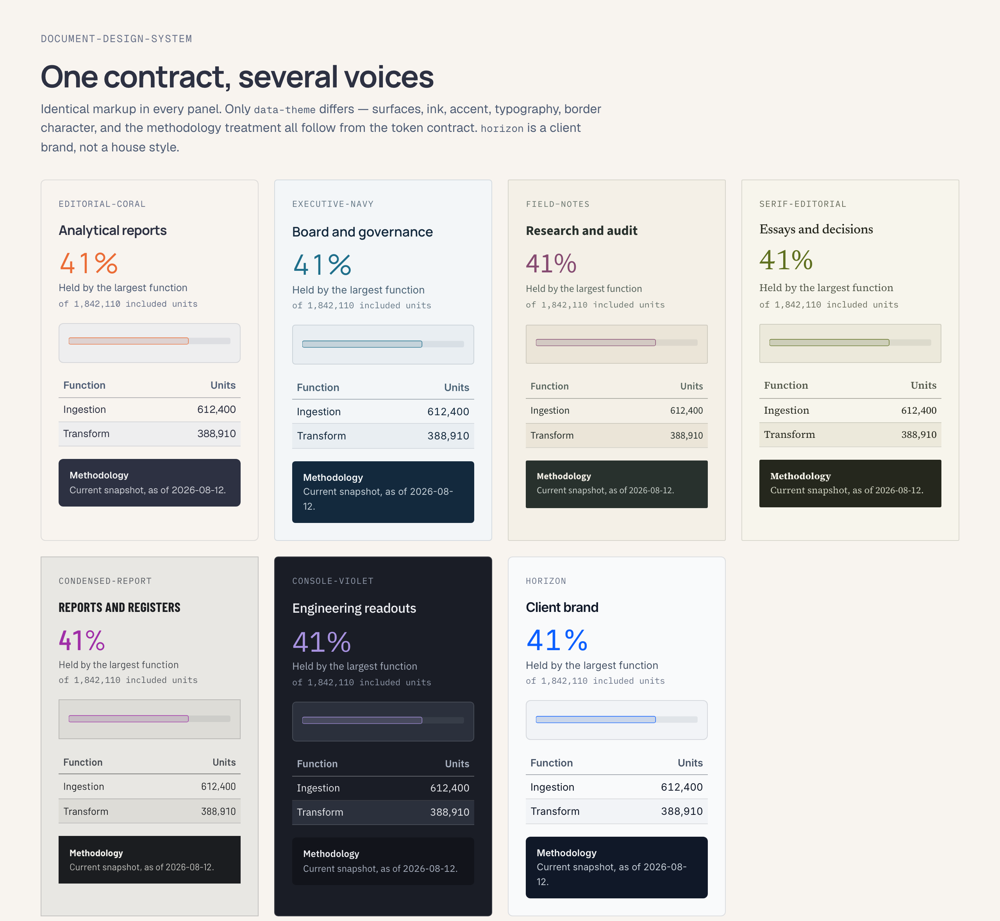
</picture>

<sub>Follows your GitHub theme · [source](examples/themes-light.html)</sub>

| Theme | Voice for |
|---|---|
| `editorial-coral` | Analysis for a wider review, the default |
| `executive-navy` | Leadership deciding and funding |
| `field-notes` | Internal working documents, research, audit |
| `serif-editorial` | Reading and deciding: essays, records, explanations, discovery |
| `condensed-report` | Scanning status reports, plans, estimates and registers |
| `console-violet` | Engineers on the incident, the gate and the pager; the dark theme |
| `horizon` | A client's brand, produced by `brand-theme-design` |
| `brand-template` | Your own brand: copy it, fill every TODO, rename it |

One proposal body, three voices: [`executive-navy`](examples/proposal.html),
[`editorial-coral`](examples/proposal-coral.html) and [`horizon`](examples/proposal-horizon.html),
the [client brand](examples/brand.html).

### Both sit on the same facts

Changing the pattern or the theme never changes a fact. A missing fact stays open rather
than being filled in:

| Claim | State |
|---|---|
| Four of the last six incidents trace to the shared queue | **Verified**, from incident tickets |
| Two independently recoverable queues reduce blast radius | **Recommended**, by RFC 014 |
| Shed and alert rather than block | **Unresolved**, Reliability owns the decision |

Markdown is the canonical form; designed HTML is built from the same title and facts, and
the build fails when the two disagree
([`evidence.md`](skills/writing-documents/references/evidence.md)). Commercial documents
never invent parties, rates, terms or dates.

---

## Figures that stay true

Diagrams and charts are SVG whose colours are `var(--...)`, so they follow the page's
theme with nothing re-rendered. Twenty-two figures sit in the example documents, each
drawn in the form its reader's question needs, from 21 diagram forms (architecture, change
view, deployment map, dependency graph, sequence, journey, story map, event model,
fishbone, cycle, evolution map and more) plus ranked bars, columns, lines and a waterfall
that refuses to render when its parts do not add up.

<picture>
  <source media="(prefers-color-scheme: dark)" srcset="docs/screenshots/gallery-dark.png">
  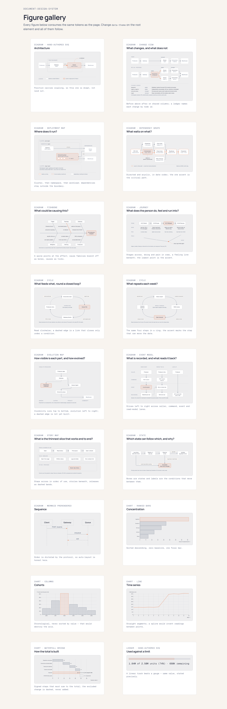
</picture>

<sub>Follows your GitHub theme · [source](examples/gallery-light.html)</sub>

Mermaid, draw.io, Excalidraw and PlantUML files are inputs: their structure is imported
and the figure is redrawn on tokens. Open any example and change one attribute,

```html
<html lang="en" data-theme="editorial-coral">   →   data-theme="executive-navy"
```

and the page, the chart's focal bar and the diagram's arrowheads move together.

---

## The skills

| Skill | Owns | Does **not** own | Example |
|---|---|---|---|
| **[writing-documents](skills/writing-documents/SKILL.md)** | 34 presets in 11 patterns, composition when none fits, evidence states; Markdown by default, designed HTML on request | Metric-led reports, casual edits, unrequested restyling | [Patterns page](examples/index.html) |
| **[analytical-document-design](skills/analytical-document-design/SKILL.md)** | Evidence models, control totals, metric and cohort semantics, methodology | Prose-first documents, slides | [Inventory report](examples/inventory-report.html) |
| **[diagram-design](skills/diagram-design/SKILL.md)** | When a diagram earns its place; 21 forms; layout and label rules; Mermaid, draw.io, Excalidraw and PlantUML import | Quantitative charts, UI mockups | [Figure gallery](examples/gallery-light.html) |
| **[chart-design](skills/chart-design/SKILL.md)** | Chart choice, axis honesty, token palettes, a waterfall that checks its totals | Narrative, dashboards as applications | [Estimate](examples/estimate.html) |
| **[presentation-design](skills/presentation-design/SKILL.md)** | 16:9 HTML slides, claim titles, one idea per slide, PDF one slide per page | Documents meant to be read; `.pptx` | [Deck](examples/capacity-deck.html) |
| **[brand-theme-design](skills/brand-theme-design/SKILL.md)** | A brand turned into a theme: extraction with provenance, role mapping, contrast audit | Choosing between shipped themes | [Brand exhibit](examples/brand.html) |

---

## Install

```
/plugin marketplace add Avinava/document-design-system
/plugin install document-design-system@document-design-system
```

The name appears twice because `@` reads "from": the plugin, from the catalog of the same
name. Each skill also installs on its own, without the plugin system:

```bash
npx skills add Avinava/document-design-system                      # all six
npx skills add Avinava/document-design-system --skill chart-design # just one
```

Each skill carries its own copy of the tokens, scripts and templates it uses, so it works
wherever it lands. Without the CLI, copy any `skills/<name>/` into `.claude/skills/`.

---

## Built on

Readers need nothing installed: a delivered document is HTML and SVG. The authoring
toolchain runs only where the document is written, pinned to exact versions; licences
and versions are in [THIRD_PARTY_LICENSES.md](THIRD_PARTY_LICENSES.md).

- **[beautiful-mermaid](https://github.com/lukilabs/beautiful-mermaid)** (MIT): Mermaid to SVG; its CSS-custom-property theming makes the zero-JavaScript retheme possible.
- **[Observable Plot](https://observablehq.com/plot/)** (ISC) with **jsdom** (MIT): chart scales and layout, rendered server-side.
- **Playwright** (Apache-2.0) and **Pillow** (MIT-CMU): PDF export, screenshots, brand extraction and the render check.
- **Design influence: [cathrynlavery/diagram-design](https://github.com/cathrynlavery/diagram-design)** (MIT, © 2025 Cathryn Lavery): the editorial standard in `diagram-design` is adapted from it: deletion as the highest-quality move, every node earning its place, one accent, density around 4/10, hairlines over shadows, a 4px grid, label geometry verified rather than eyeballed, and diagram files as structure to redraw. No code is used; the credit is also in the skill.
- Anthropic's **skill-creator** conventions: progressive disclosure and description writing.

## Contributing

Repository layout, how to add a type, module, theme or diagram form, the toolchain, the
checks that fail the build, and the decision records are in
[CONTRIBUTING.md](CONTRIBUTING.md) and [docs/DESIGN.md](docs/DESIGN.md).

## License

MIT, see [LICENSE](LICENSE).
